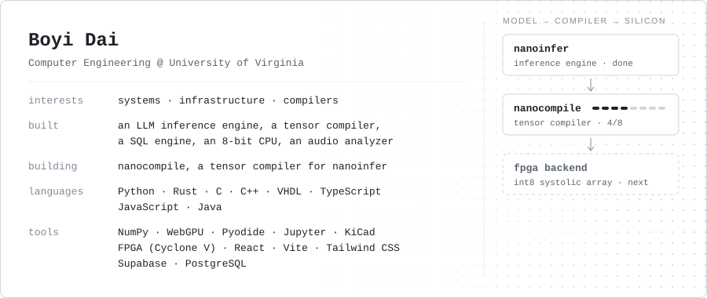

<!-- The card has a dark and a light version; GitHub shows the one that
     matches the viewer's theme. -->
<picture>
  <source media="(prefers-color-scheme: dark)" srcset="./card-dark.svg">
  
</picture>

**Portfolio:** [spookyjumpybeans.github.io/boyidai](https://spookyjumpybeans.github.io/boyidai/)
